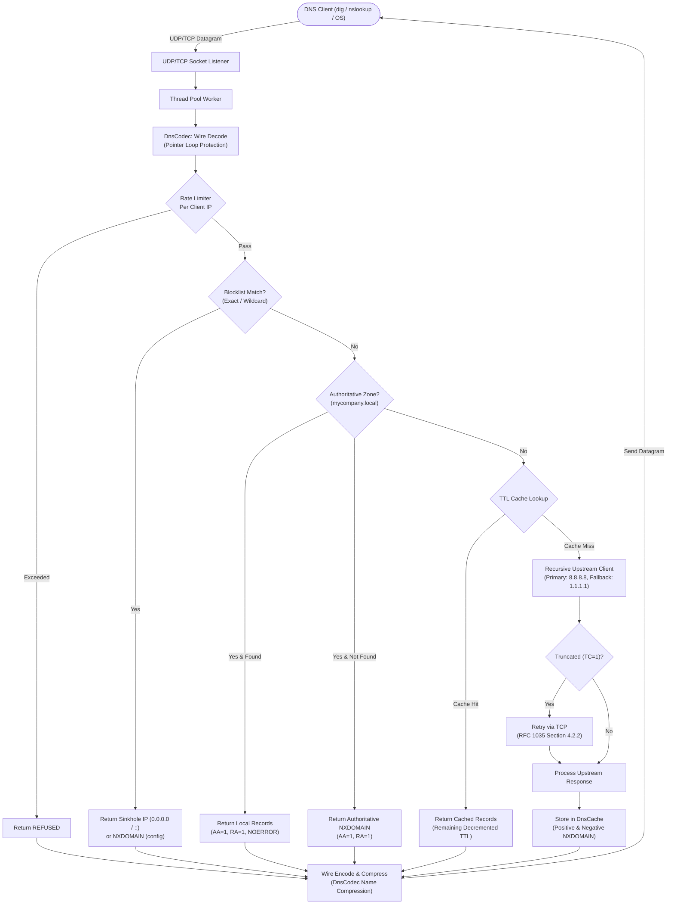

# Standalone DNS Server & Recursive Resolver with Caching (`dns-system`)

A complete, RFC-compliant DNS Server and Recursive Resolver built from scratch on raw UDP and TCP sockets in **Java 17** without any external DNS libraries. It includes a custom wire-format binary parser/encoder, pointer name compression, authoritative BIND-style zone storage, ad/malware domain filtering, a TTL-based cache with negative caching, a multi-threaded request engine, a built-in `dig`-like CLI client, and a real-time dark-themed **Swing GUI Dashboard**.

---

## 🏛 Architecture & Resolution Flow



---

## 📁 Project Structure

```
dns-system/
├── pom.xml
├── src/main/java/com/dns/
│   ├── Main.java                         # Unified launcher (server, gui, dig)
│   ├── protocol/
│   │   ├── DnsMessage.java               # DNS Packet representation (Header + Sections)
│   │   ├── DnsHeader.java                # 12-byte header, flags (QR, AA, TC, RD, RA, RCODE)
│   │   ├── DnsQuestion.java              # Question section (QNAME, QTYPE, QCLASS)
│   │   ├── DnsRecord.java                # Resource record wire & parsed values
│   │   ├── RecordType.java               # Enum: A, AAAA, CNAME, MX, TXT, NS, PTR, SOA, ANY
│   │   └── DnsCodec.java                 # Custom wire encoder/decoder with pointer compression
│   ├── server/
│   │   ├── DnsServer.java                # Multithreaded UDP/TCP listener & lifecycle
│   │   ├── QueryHandler.java             # Core resolution pipeline coordinator
│   │   └── ZoneStore.java                # BIND zone file parser & authoritative store
│   ├── resolver/
│   │   ├── RecursiveResolver.java        # Recursive query coordinator
│   │   └── UpstreamClient.java           # Raw socket client with timeout & TCP fallback
│   ├── cache/
│   │   └── DnsCache.java                 # Concurrent TTL cache & negative NXDOMAIN caching
│   ├── filter/
│   │   └── BlockList.java                # Exact and wildcard ad/malware domain filter
│   ├── stats/
│   │   ├── QueryStats.java               # Atomic metrics, QPM sliding window, top domains
│   │   └── QueryLogger.java              # Async file writer & real-time GUI event broadcaster
│   ├── client/
│   │   └── DigClient.java                # Full-featured dig-like CLI tool
│   ├── gui/
│   │   └── DnsDashboard.java             # Modern Swing monitoring dashboard
│   └── util/
│       ├── ConfigLoader.java             # Properties loader with intelligent defaults
│       └── Logger.java                   # Thread-safe console logger with timestamps
├── config/
│   └── dns.properties                   # Port, upstreams, cache limits, rate limits
├── zones/
│   └── local.zone                       # Sample authoritative zone with A, AAAA, CNAME, MX, TXT
├── blocklists/
│   └── sample.txt                       # Sample ad/malware domain blocklist with wildcards
├── logs/
│   └── dns-queries.log                  # Live log output
├── src/test/java/com/dns/
│   ├── protocol/DnsCodecTest.java       # Wire encoding, decoding, pointer compression tests
│   ├── cache/DnsCacheTest.java          # TTL expiry and negative caching tests
│   ├── filter/BlockListTest.java        # Exact and wildcard matching tests
│   ├── server/ZoneStoreTest.java        # Zone parser and authoritative lookup tests
│   └── server/QueryHandlerTest.java     # Full resolution pipeline unit tests
└── README.md
```

---

## ⚡ Features & RFC Compliance

1. **Zero External DNS Libraries**:
   - Packets are parsed and assembled directly using `java.net.DatagramPacket`, `java.io.ByteArrayOutputStream`, and byte buffers.
2. **RFC 1035 Name Compression**:
   - Encodes repeated domain labels using `0xC000 | offset` pointer compression.
   - Decompresses pointer labels with loop-detection protecting against malicious circular compression pointers.
3. **Record Types Supported**:
   - `A` (IPv4)
   - `AAAA` (IPv6 - RFC 3596)
   - `CNAME` (Canonical name alias resolution)
   - `MX` (Mail exchange with preference priority)
   - `TXT` (Character-string text records)
   - `NS` (Authoritative nameservers)
   - `PTR` (Reverse DNS pointers)
   - `SOA` (Start of Authority)
4. **Authoritative Zone (`local.zone`)**:
   - Parses standard BIND-style zone files (`$ORIGIN`, `$TTL`, comments, multi-line parentheses).
   - Sets the `AA` (Authoritative Answer) and `RA` (Recursion Available) flags.
   - Responds with `NOERROR`, authoritative `NXDOMAIN`, or `NODATA`.
5. **Recursive Forwarding & Upstream Fallback**:
   - Forwards unknown domains to upstream DNS servers (e.g. `8.8.8.8:53` and `1.1.1.1:53`).
   - Configurable timeout with automatic fallback to secondary upstream.
6. **TCP Fallback on Truncation (`TC=1`)**:
   - If an upstream UDP reply has `TC=1` or exceeds 512 bytes, automatically reconnects and queries via TCP (RFC 1035 Section 4.2.2).
   - Server runs simultaneous UDP and TCP listeners on the same port.
7. **TTL-Based Caching & Negative Caching (RFC 2308)**:
   - Dynamic TTL decrements remaining time on each hit.
   - Caches `NXDOMAIN` responses for negative TTL duration.
   - Real-time cache hit ratio and cache flush operations.
8. **Ad & Malware Blocklist Filtering**:
   - Exact matching (e.g. `badware-tracker.com`).
   - Wildcard matching (e.g. `*.doubleclick.net`, `adserver.*`).
   - Sinkholes to `0.0.0.0` (or `::` for IPv6) or returns `NXDOMAIN`.
9. **Multi-Threaded & Resilient**:
   - Worker thread pool to handle concurrent requests.
   - Sliding-window rate limiter per client IP returning `REFUSED` on floods.
   - Resilient port binding: gracefully handles port conflicts (e.g. if mDNS / Chrome occupies 5353, automatically binds next available port).
10. **Swing GUI Dashboard**:
    - Dark mode aesthetics, live scrolling query table with color-coded badges (`ZONE`, `CACHE`, `UPSTREAM`, `BLOCKED`).
    - Custom anti-aliased circular cache efficiency gauge.
    - Top queried and top blocked domains ranking.
    - Interactive controls: **Flush Cache**, **+ Add Local Record**, **Reload Zone**, and **Reload Blocklist**.

---

## 🚀 Building & Running

### Prerequisites
- **Java 17+**
- **Apache Maven 3.8+**

### 1. Build and Run Tests
```bash
cd dns-system
mvn clean test
```
*Executes all 24 unit tests covering codec, compression, cache, blocklist, and zone stores.*

### 2. Package the Executable JAR
```bash
mvn package -DskipTests
```
Generates `target/dns-system-1.0.0.jar`.

### 3. Start the DNS Server
```bash
# Standard CLI mode (default port 5353 or next available)
java -jar target/dns-system-1.0.0.jar

# Or specify a custom port:
java -jar target/dns-system-1.0.0.jar --port=5354

# Or launch with the Swing Dashboard GUI:
java -jar target/dns-system-1.0.0.jar --gui
```

---

## 🔍 Querying the Server

### Using the Built-In `DigClient`
The project comes with a built-in CLI tool that formats output identically to BIND `dig`:

```bash
# Query local authoritative record
java -cp target/dns-system-1.0.0.jar com.dns.client.DigClient "@127.0.0.1" -p 5354 www.mycompany.local A

# Query upstream external domain (Uncached -> Upstream)
java -cp target/dns-system-1.0.0.jar com.dns.client.DigClient "@127.0.0.1" -p 5354 example.com A

# Query same external domain again (Cached -> Fast 0-1ms with decremented TTL)
java -cp target/dns-system-1.0.0.jar com.dns.client.DigClient "@127.0.0.1" -p 5354 example.com A

# Query blocked ad domain (returns 0.0.0.0)
java -cp target/dns-system-1.0.0.jar com.dns.client.DigClient "@127.0.0.1" -p 5354 ads.doubleclick.net A

# Query non-existent host in authoritative zone (returns NXDOMAIN)
java -cp target/dns-system-1.0.0.jar com.dns.client.DigClient "@127.0.0.1" -p 5354 ghost.mycompany.local A

# Query other record types: MX, TXT, AAAA, CNAME
java -cp target/dns-system-1.0.0.jar com.dns.client.DigClient "@127.0.0.1" -p 5354 mycompany.local MX
java -cp target/dns-system-1.0.0.jar com.dns.client.DigClient "@127.0.0.1" -p 5354 mycompany.local TXT
java -cp target/dns-system-1.0.0.jar com.dns.client.DigClient "@127.0.0.1" -p 5354 api.mycompany.local AAAA
java -cp target/dns-system-1.0.0.jar com.dns.client.DigClient "@127.0.0.1" -p 5354 web.mycompany.local CNAME

# Query over TCP (forces TCP connection with 2-byte length framing)
java -cp target/dns-system-1.0.0.jar com.dns.client.DigClient "@127.0.0.1" -p 5354 www.mycompany.local A +tcp
```

### Using Standard `dig` or `nslookup`
```bash
# Real dig command (Linux / macOS / Git Bash)
dig @127.0.0.1 -p 5354 www.mycompany.local A

# Windows nslookup (Note: specify port in interactive mode or via port flag)
nslookup -port=5354 www.mycompany.local 127.0.0.1
```

---

## 🖥 Swing Dashboard GUI

Launch the GUI by running:
```bash
java -cp target/dns-system-1.0.0.jar com.dns.Main gui
# Or alongside server:
java -jar target/dns-system-1.0.0.jar --gui
```

### Dashboard Capabilities:
- **Metric Cards**: Total Queries, Cache Hit Ratio %, Blocked Count, Queries per Minute (QPM), Upstream Queries.
- **Custom Arc Gauge**: Visual circular gauge rendering the cache efficiency ratio in real time.
- **Live Query Stream**: Table updating with timestamp, client IP, domain, query type, result code, source badge (`ZONE`, `CACHE`, `UPSTREAM`, `BLOCKED`), and latency in milliseconds.
- **Top Tables**: Dynamically sorted rankings of Top Queried Domains and Top Blocked Domains.
- **Interactive Control Bar**:
  - **Flush Cache**: Instantly purges all cached entries.
  - **+ Add Record**: Modal dialog allowing on-the-fly addition of A, AAAA, CNAME, MX, or TXT records without restarting.
  - **Reload Zone**: Re-reads `zones/local.zone` from disk.
  - **Reload Blocklist**: Re-reads `blocklists/sample.txt` from disk.

---

## ⚙️ Configuration Reference (`config/dns.properties`)

| Key | Default | Description |
|---|---|---|
| `server.port` | `5353` | Default port (fallback automatically if occupied) |
| `server.host` | `0.0.0.0` | Bind IP interface |
| `server.tcp.enabled` | `true` | Enable TCP fallback & listener |
| `upstream.servers` | `8.8.8.8:53,1.1.1.1:53` | Primary and fallback recursive resolvers |
| `upstream.timeout.ms` | `2000` | Timeout before trying fallback upstream |
| `cache.max_size` | `10000` | Maximum cached records |
| `cache.negative_ttl_seconds` | `300` | TTL for NXDOMAIN negative caching |
| `blocking.enabled` | `true` | Enable ad/malware domain filter |
| `blocking.mode` | `ip` | `ip` (0.0.0.0 / ::) or `nxdomain` |
| `ratelimit.requests_per_second` | `50` | Max queries per second per client IP |
| `threads.pool_size` | `16` | Worker thread pool size |
